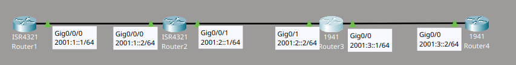
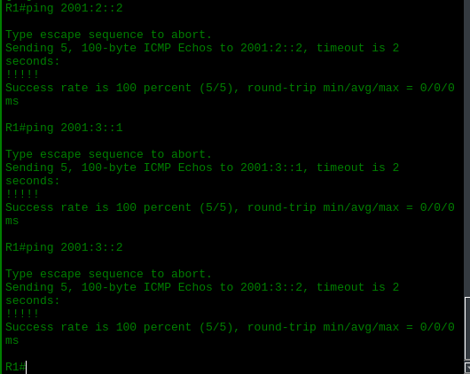
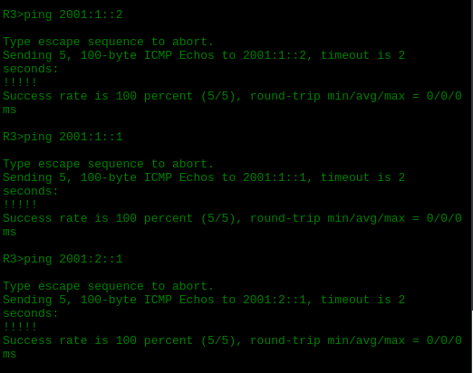

# IPv6 Lab 1

## Descripción del laboratorio

Material proporcionado por **David Bombal**

Tareas a completar:
1. Configurar los hostnames de los dispositivos
2. Configurar las direcciones IPv6 según se muestra en el diagrama de topología
3. Configurar el static routing de IPv6 usando redes /64
4. Verificar la conectividad

## Topología



## Configuración de host names y direcciones IPv6

Empiezo asignando el hostname a cada router y activando el IPv6 unicast-routing, ya que este comando es necesario para que el router pueda enrutar tráfico IPv6. Después configuro la dirección IPv6 en cada interfaz según la topología.

En R1 configuro la interfaz que lo conecta con R2:

```cmd
Router(config)#hostname R1
R1(config)#ipv6 unicast-routing
!
R1(config)#int g0/0/0
R1(config-if)#ipv6 address 2001:1::1/64
R1(config-if)#no shut
```

En R2 configuro las dos interfaces, una hacia R1 y otra hacia R3, ya que este router actúa como intermediario entre ambos:

```cmd
Router(config)#hostname R2
R2(config)#ipv6 unicast-routing
!
R2(config)#int g0/0/0
R2(config-if)#ipv6 address 2001:1::2/64
R2(config-if)#no shut
!
R2(config-if)#int g0/0/1
R2(config-if)#ipv6 address 2001:2::1/64
R2(config-if)#no shut
```

De la misma manera, en R3 configuro la interfaz hacia R2 y la interfaz hacia R4:

```cmd
Router(config)#hostname R3
R3(config)#ipv6 unicast-routing
!
R3(config)#int g0/1
R3(config-if)#ipv6 address 2001:2::2/64
R3(config-if)#no shut
!
R3(config-if)#int g0/0
R3(config-if)#ipv6 address 2001:3::1/64
R3(config-if)#no shut
```

Por último, en R4 configuro únicamente la interfaz hacia R3, ya que es el último router de la topología:

```cmd
Router(config)#hostname R4
R4(config)#ipv6 unicast-routing
!
R4(config)#int g0/0
R4(config-if)#ipv6 address 2001:3::2/64
R4(config-if)#no shut
```

## Configuración de static routes

Una vez asignadas las direcciones, configuro el static routing en cada router para que conozca las redes que no están directamente conectadas a él. En cada caso, indico la red de destino, la interfaz de salida y la dirección IPv6 del siguiente salto (next hop).

En R1 apunto hacia R2 para alcanzar tanto la red de R2-R3 como la red de R3-R4:

```cmd
R1(config)#ipv6 route 2001:2::/64 g0/0/0 2001:1::2
R1(config)#ipv6 route 2001:3::/64 g0/0/0 2001:1::2
```

En R2 solo necesito una ruta adicional, ya que la red hacia R1 está directamente conectada:

```cmd
R2(config)#ipv6 route 2001:3::/64 g0/0/1 2001:2::2
```

En R3 configuro la ruta de vuelta hacia la red de R1-R2:

```cmd
R3(config)#ipv6 route 2001:1::/64 g0/1 2001:2::1
```

Finalmente, en R4 configuro las rutas hacia las dos redes restantes, apuntando siempre hacia R3:

```cmd
R4(config)#ipv6 route 2001:2::/64 g0/0 2001:3::1
R4(config)#ipv6 route 2001:1::/64 g0/0 2001:3::1
```

## Verificación de la conectividad

Para confirmar que el static routing funciona correctamente, realizo pruebas de ping entre los routers de los extremos de la topología. De esta manera compruebo que el tráfico IPv6 atraviesa correctamente los routers intermedios.




