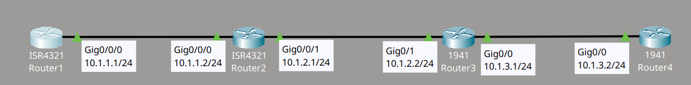
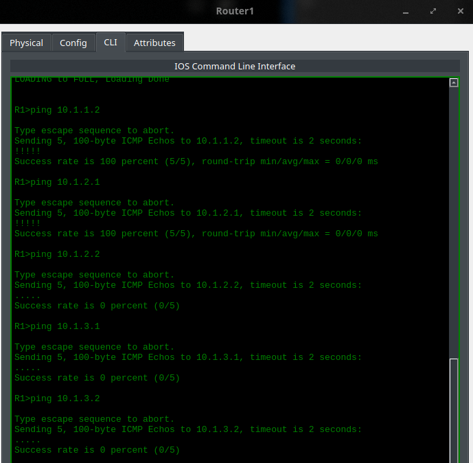
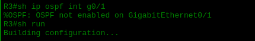
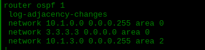
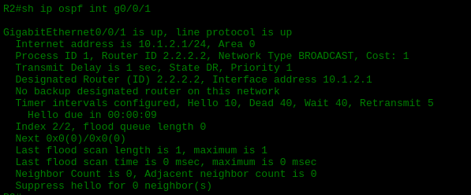
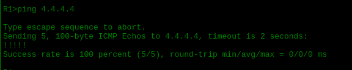

# OSPF Troubleshooting Lab 3

## Descripción del lab

Material proporcionado por **David Bombal**.

Este lab consiste en una topología de cuatro routers Cisco conectados en serie mediante interfaces Gigabit Ethernet, dentro del proceso OSPF. El ticket indica que Router1 no puede hacer ping a la loopback interface de Router4. El objetivo es identificar la causa del fallo y restablecer la conectividad.

## Topología



## El problema

Empecé haciendo ping desde Router1 hacia las distintas direcciones de la red para localizar dónde se producía el fallo. Las respuestas eran correctas hasta la dirección 10.1.2.1, pero al llegar a 10.1.2.2, que corresponde a una interface de Router3, el ping dejaba de funcionar, al igual que en las direcciones posteriores.



Revisé entonces el enlace OSPF entre Router2 y Router3 y comprobé, mediante los comandos de verificación, que OSPF no estaba habilitado en esa interface.



## Diagnóstico y solución

Para averiguar la causa, revisé la running-config de Router3 y encontré el origen del problema: la red anunciada en el proceso OSPF era incorrecta. En lugar de anunciar la red 10.1.2.0/24, que es la que corresponde a la interface conectada con Router2, se estaba anunciando la red 10.1.0.0/24, que no existe en esa interface.



Confirmé el problema revisando la interface en Router2, donde el neighbor count aparecía en 0, es decir, sin ninguna vecindad OSPF formada.



Corregí la configuración en Router3 eliminando el network statement incorrecto y añadiendo el correcto dentro del area 0:

```cmd
R3(config)#router ospf 1
R3(config-router)#no network 10.1.0.0 0.0.0.255 area 0
R3(config-router)#network 10.1.2.0 0.0.0.255 area 0
```

## Verificación

Probé de conectividad desde Router1 hacia la loopback interface de Router4 y el ping fue exitoso:


